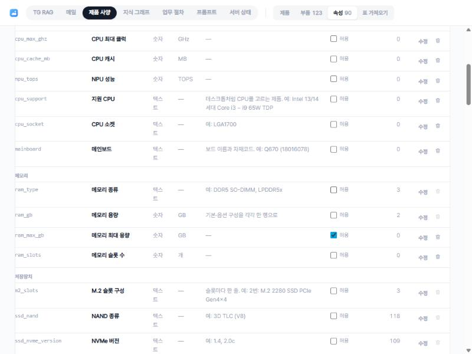

# E-E4 화면: 상위 모델 값 물려받기 허용

## 변경 파일
- `frontend/src/spec/api.ts`: `SpecAttribute.inheritable: number`, `updateAttribute` 패치에 `inheritable?: boolean`
- `frontend/src/spec/AttributesTab.tsx`
  - 표에 "상위 모델 값 물려받기" 열과 체크박스 하나(`InheritCell`). 누르면 바로 `PUT /specs/attributes/{key}` `{inheritable}`를 보내고 안내 줄을 띄운다
  - 분류가 `cert`인 행은 체크박스를 끄고(비활성) "인증은 물려받지 않음"과 이유(마우스를 올리면 "인증은 모델마다 따로 받으므로 상위 모델에서 물려받지 않습니다")를 보인다
  - 머리 설명에 물려받기 규칙 두 문장
  - 수정 중인 행의 체크박스는 잠근다 (수정 저장과 겹치지 않게)
- 그 밖의 화면·엑셀 양식은 바꾸지 않았다.

## 확인: 명령과 결과
```
cd frontend && npx tsc -b && npx eslint src/spec
(출력 없음, 종료 코드 0)
```
dev 서버 확인 (`rag-qa-frontend-stub8010` → 확인용 백엔드 8010):
- 확인용 백엔드는 운영 `mail.db`를 `mode=ro`로 열어 sqlite backup으로 만든 **사본**에 사양·고객방·그래프 라우터만 띄웠다 (운영 경로 연결을 사본으로 돌린 뒤 저장소 임포트). 사본에는 `_migrate`가 `inheritable` 컬럼을 만들었다.
- `/spec?tab=attributes`: 체크박스 90개, 인증·규격 4개(`cert_model`, `kc_safety`, `kc_emc`, `energy_efficiency`)는 비활성·"인증은 물려받지 않음"
- "메모리 최대 용량" 체크 → 안내 "'메모리 최대 용량': 파생 모델에 값이 없으면 상위 모델 값을 물려받습니다.", API에서 `ram_max_gb` `inheritable=1`, `kc_safety` 0
- 운영 `storage/mail.db` 수정 시각 13:59 그대로



## 확인하지 못한 것
- 운영 화면은 사용자의 `npm run build`와 서버 재시작 뒤 보인다. 어떤 속성을 허용할지는 R&D가 정한다 (지시서 10-2).
