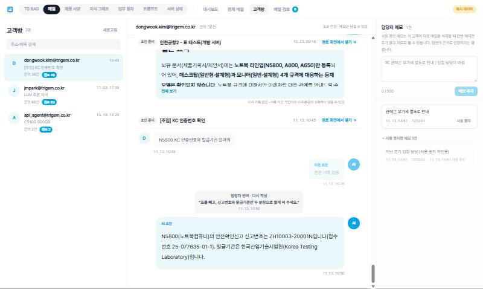

# G-G2 고객방 담당자 메모 화면

## 변경 파일
- `frontend/src/mail/CustomerNotes.tsx`(신규): 고객방 오른쪽의 "담당자 메모"
  - 새 메모 입력(500자, 글자 수 표시, 넘으면 저장 버튼 꺼짐) → `POST /customers/{sender}/notes`
  - 사용 중인 메모 목록(작성 시각·작성 IP)과 "사용 중지"(확인 창, 지우지 않음) → `POST …/notes/{id}/retire`
  - "사용 중지한 메모 N건"은 접어 두고 펼치면 흐리게 보인다
  - 설명: 사용 중인 메모는 다음 메일을 처리할 때 답변 에이전트가 참고 자료로 볼 수 있고, 근거로 인용되지 않는다
  - 예시 데이터(고객방 API에 닿지 않음)에서는 메모를 남길 수 없다고 표시
- `frontend/src/mail/pages/MailCustomersPage.tsx`: 타임라인과 메모를 한 묶음으로. 넓은 화면(xl, 1280px 이상)은 메모가 오른쪽(320px), 좁으면 타임라인 아래(화면 높이 42%까지). 머리줄 "조회 전용" → "조회 전용 · 메모만 남길 수 있음"
- `frontend/src/mail/api.ts`: `customerApi.notes`, `addNote`, `retireNote`
- `frontend/src/mail/types.ts`: `CustomerNote`

고객방은 여전히 승인·반려·편집을 하지 않는다. 메모만 한다.

## 확인: 명령과 결과
```
cd frontend && npx tsc -b && npx eslint src/mail
(출력 없음)
```
dev 서버 확인 (`rag-qa-frontend-stub8010` → 확인용 백엔드 8010, 운영 `mail.db`를 `mode=ro`로 열어 만든 **사본**):
- `/mail/customers?sender=dongwook.kim@trigem.co.kr`: 메모 입력란에 "견적은 부가세 별도로 안내"를 쓰고 "메모 추가" → 목록에 보임(작성 IP 127.0.0.1)
- API로 메모 하나를 더 넣고 사용 중지 → "사용 중지한 메모 1건" 아래에 흐리게, 사용 중 1건
- 501자 → 400
- 고객방 화면의 버튼 중 승인·반려·편집·수정·발송 0개
- 1024px: 메모가 타임라인 아래 / 1440px: 오른쪽 (아래 그림)



운영 `storage/mail.db` 확인 (`mode=ro`): `customer_note` 테이블·`inheritable`·`ref_type` 컬럼이 **없다** (이번 작업의 스키마가 운영에 들어가지 않았다). 같은 시각(14:50)의 수정 시각 변화는 사용자 서버의 접속 기록(`access_log` 05:50:32Z `GET /skills`)이다.

## 확인하지 못한 것
- 운영 화면은 사용자의 `npm run build`와 서버 재시작 뒤 보인다.
