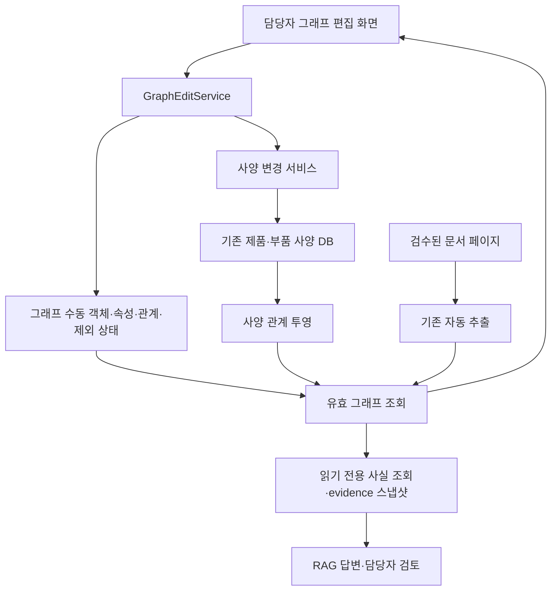

# 그래프 사용자 개입 기능 — 개발 계획서

작성일: 2026-11-13. 상태: **검토용 계획, 구현 미착수**.
선행 판단: [사전 판단서](/C:/TG_AI_DEV/rag_QA/docs/graph_user_editing_assessment_2026-11-13.md).
기존 미커밋 수정·사용자 파일·운영 DB는 이번 문서 작성에서 변경하지 않는다.

## 1. 목표와 범위

담당자가 객체와 관계를 직접 관리하고, 사용자 정의 속성을 입력하며, 자동 재추출·사양 동기화 뒤에도 그 편집이 보존되게 한다. 입력한 지식은 출처와 버전을 확인할 수 있는 읽기 경로를 통해 RAG 답변에 반영한다.

### 1차 필수

- 관계 없이 객체 생성, 객체 이름/별칭 편집, 그래프에서 삭제·복구.
- 객체 속성의 정의와 값 추가·수정·삭제. 자료형·단위·선택지를 입력할 수 있음.
- 사용자 정의 관계 종류 등록과 객체 간 관계 추가·수정·삭제/복구.
- 문서 추출·사양 DB·사용자 입력의 표시 및 수정 경로 구분.
- 변경 전후 이력, 충돌 감지, 재추출·재시작 후 사용자 입력 보존.
- 사용자 속성·관계의 검색·상세 읽기·근거 등록과 삭제/수정 후 답변 갱신.

### 2차 선택

사용자 정의 객체 분류, 자동 관계의 임의 속성, 대량 편집·가져오기, AI의 새 종류/속성 추출 제안. 1차는 기존 객체 종류 7종을 유지한다. 객체의 속성 값 추가와 객체 분류 자체의 추가를 구분한다.

사용자 정의 관계가 곧 대체 적합·인증 적용·사양 상속을 뜻하지 않는다. 사용자 정의 관계에 자동 전이·추론 규칙을 붙이거나 AI가 편집을 자동 승인하는 기능은 1차에 포함하지 않는다.

## 2. 핵심 저장 원칙

1. 자동 원본과 사용자 판단을 구분해 저장한다. 사용자 삭제는 제외 상태, 수정은 수동 사실과 원래 사실의 제외로 남긴다.
2. 같은 기술 사양을 graph 속성과 spec_value에 각각 저장하지 않는다. 그래프 화면이 사양 수정의 진입점이 될 수는 있다.
3. 개체 삭제는 복구 가능한 상태 변경이다. 원본 문서·제품·부품 행을 함께 삭제하지 않는다.
4. 수동 값과 변경 이력은 파일 삭제·재추출·사양 재동기화의 정리 대상에서 제외한다.
5. 새 속성·관계 종류는 레지스트리의 행으로 추가한다. 사용자 추가마다 DB 컬럼이나 Python 코드를 생성하지 않는다.
6. 객체 ID·별칭·사양 ref를 보존한다. 자동 관계 row ID는 재생성될 수 있으므로 장기 사용자 데이터의 연결 키로 쓰지 않는다.

## 3. 사양 DB와 그래프 편집의 경계

| 담당자가 하는 일 | 저장 위치·처리 |
| --- | --- |
| RAM 용량·중량·인증번호 등 제품/부품 사양 추가·변경 | 기존 spec_attribute/spec_value 및 사양 API. 그래프 화면에서 같은 폼으로 진입 가능 |
| 제품의 상위 모델·구성 부품·옵션 변경 | parent_id/product_component 변경 후 기존 spec 그래프 동기화 |
| 검토 메모·적용 업무 구분 등 그래프 추가 정보 | graph_property_definition/value |
| 사용자 정의 "대체 후보", "관련 자료" 관계 추가 | 그래프의 manual 관계. 조건·사유는 메모로 표시 |
| 사양 관계를 그래프에서 보이지 않게 함 | 그래프 제외 상태. 실제 사양 연결은 유지 |
| 사양의 구성 부품 연결 자체를 해제 | 사양 변경 동작으로 명시하고 product_component를 수정 |

속성 추가 화면에서 **제품 사양 / 그래프 추가 정보**를 먼저 고른다. 제품 사양을 선택하면 기존 사양 속성을 찾거나 신규 사양 속성을 등록한다. 그래프용 속성의 숫자 값은 표시·사실 조회에 사용하며, compare_specs가 이를 자동으로 기술 사양으로 해석하지 않는다.

제품/부품 객체를 만들 때 기존 사양 DB 항목을 검색해 연결한다. 신규 관리 제품으로 등록하는 동작과 문서/그래프상의 객체만 만드는 동작을 구분한다. 모델명·부품 ID·상위 모델처럼 사양 DB가 소유하는 항목은 그래프에서 별도 값으로 덮어쓰지 않는다.

## 4. 데이터 모델 제안

정확한 DDL은 구현 1단계에서 사본 마이그레이션과 함께 확정한다. 아래는 구현해야 하는 의미 계약이다.

### 4-1. graph_entity 확장

- `creation_origin`: extract / seed / spec / manual.
- `lifecycle_state`: active / deleted / merged. 과거 ID와 별칭을 유지한다.
- `manual_retained`: 사용자가 만들거나 추가 정보를 입력한 객체를 자동 고아 정리에서 보호.
- `display_name`: 사양의 정식 모델명과 구분하는 선택 표시명.
- `revision`, `updated_at`, `deleted_at`, `merged_into_id` 및 변경 주체 참조.

기존 객체는 생성 출처를 확실히 알 수 없으면 legacy로 표시한다. 수동 관계가 연결된 기존 객체는 보존한다. 표시 이름만으로 사양 ref를 새 대상에 연결하지 않는다.

`_upsert_entity`는 삭제된 객체의 별칭·정식 식별자도 찾아야 한다. 재추출로 같은 이름을 만났다고 삭제 상태를 풀거나 새 ID로 우회 생성하지 않는다. 복구는 사용자 동작으로만 한다.

### 4-2. graph_relation_type 신규

`key`, `label`, `description`, `source_entity_types`, `target_entity_types`, `active`, `builtin`, `revision`, 작성·변경 시각.

- 기존 7종을 최초 한 번 등록. 시스템 키와 사양 관계의 의미는 고정한다.
- 사용자 종류는 `custom:<slug>` 같은 별도 namespace. 한글 표시명과 내부 키를 분리한다.
- 1차 관계는 방향이 있는 관계로 제공한다. 입력 폼에서 방향을 미리 보여준다.
- 출발·도착 종류, 자기 연결 허용 여부를 서버에서 검사한다. 시스템 관계의 특별 규칙은 유지한다.
- 사용 중인 종류는 비활성화할 수 있으나, 그 종류의 기존 관계를 삭제하지 않는다. 의미를 바꾸는 정의 변경은 영향 미리보기와 버전 변경을 요구한다.

### 4-3. graph_property_definition 신규

`property_id`, `key`, `label`, `value_type`, `unit`, `allowed_values`, `allowed_entity_types`, `multiple`, `active`, `revision`.

자료형은 text / number / boolean / date / enum으로 시작한다. 단위는 number에만, 선택지는 enum에만 설정한다. 이름·키 중복과 시스템 예약어를 검사한다. 사용 중인 속성의 자료형·단위는 단순 수정으로 재해석하지 않고 새 버전/새 정의로 이관한다.

표시용 입력 한도와 페이지네이션은 설정으로 관리한다. 제안 초기값은 이름 100자, 설명/텍스트 값 4,000자, 객체당 사용자 속성 50개이며 실제 화면·조회 부하 검증 후 조정한다.

### 4-4. graph_property_value 신규

`value_id`, `entity_id`, `property_id`, 자료형별 값 컬럼, `revision`, `lifecycle_state`, 작성·변경 시각.

- text/enum, number, boolean, date 값을 자료형에 맞게 저장한다. 숫자 NaN/무한대, 잘못된 날짜·선택지·단위는 거부한다.
- 정의와 값의 호환성 및 단일/복수 값 제약은 트랜잭션 안에서 검사한다.
- 객체·정의는 FK로 연결하고, 객체 삭제/정의 비활성화 때문에 과거 값을 연쇄 삭제하지 않는다.
- 값이 없음, 명시적 미지원, 사용자 미확정은 구분한다. 미확정을 확정 사양으로 변환하지 않는다.

### 4-5. 수동 관계와 근거 참조

수동 관계에 상태·revision·변경 주체를 추가하고, 삭제·수정 시 과거 행을 즉시 없애지 않는다. 방향/종류 변경은 이전 상태를 남기고 새 상태를 적용한다. 동일 triple의 문서·사양 근거가 여러 개일 수 있음을 유지한다.

각 출처 주장에 `source_key`를 둔다. 기존 manual 행은 기존 ID를 포함한 고유 key로 이관하고, 자동 행은 파일/페이지 또는 사양 원본의 출처를 식별한다. 유일성은 논리 관계와 출처 key를 함께 기준으로 한다. 여러 문서에 연결된 수동 행의 file_id를 NULL로 바꾸며 기존 유일 인덱스와 충돌해 하나를 버리는 방식은 허용하지 않는다. 화면은 논리 관계를 묶어 표시할 수 있지만 개별 출처·기존 ID는 보존한다.

`graph_fact_source`를 두어 수동 관계/속성 값의 입력 사유, 선택한 파일·페이지·버전·발췌/해시를 보관한다. 사용자 입력 자체와 파일이 입증한 내용을 구분한다. 파일 선택만으로 자동 검증 완료로 표시하지 않는다.

기존 `manual` 관계의 파일 참조는 사본 마이그레이션에서 별도 출처 행으로 옮기고, manual 사실이 파일 FK의 CASCADE에 묶이지 않게 한다. 파일 삭제 후에는 "근거 파일 삭제됨"으로 표시하되 입력·출처 스냅샷·편집 이력은 남긴다. extract 관계의 파일 삭제 동작은 유지한다.

### 4-6. 제외 상태와 변경 이력

기존 graph_relation_block의 정규화 이름 규칙은 보존하면서, 새 차단은 안정적인 객체 ID와 관계 key·적용 출처 범위로 관리한다. 이름 변경·병합 후에도 제외 판단이 유지되어야 한다. 매핑할 수 없는 과거 차단은 legacy 규칙으로 남기고 임의로 지우지 않는다.

`graph_edit_event`: 대상 종류/ID, 동작, before/after, 예상·결과 revision, 수정자 정보, 시각, 요청 correlation ID. 이력을 지우는 방식의 취소가 아니라, 기존 변경을 되돌리는 새 이벤트를 추가한다.

현재 앱에 인증된 수정자 식별 체계가 없다면 세션·입력한 담당자 표시·요청 정보를 구분해 기록하며 인증된 사용자라고 표현하지 않는다. 쓰기 API에도 운영의 편집 허용 정책을 적용한다. 새 SSO 플랫폼 구축은 이번 범위에 넣지 않는다.

## 5. 객체 삭제·복구·병합 정책

### 객체 삭제

1. 연결 수, 수동 속성, 사양 ref, 영향받는 문서/관계를 미리 보여준다.
2. 저장 시 active → deleted로 변경하고 normal 그래프 조회·탐색·AI 읽기에서 제외한다.
3. 같은 객체가 다른 파일이나 사양 동기화에 나타나도 자동 복구하지 않는다.
4. 원본 문서와 사양 DB의 행은 유지한다. "그래프에서 제외"와 "사양 원본 삭제"는 별도 기능이다.

### 복구

객체 ID·별칭·속성을 유지해 복구한다. 관계는 양 끝 객체와 종류가 유효한지 검사한다. 삭제된 상대 객체나 사라진 파일을 자동 복구하지 않고 확인할 항목을 보여준다.

### 관계 삭제

사용자 정의/수동 관계는 삭제 상태로 보관한다. 문서 추출 관계는 선택한 주장만 제외하거나 해당 논리 관계 전체를 제외하는 범위를 명시한다. 사양 DB 관계는 그래프 제외와 실제 사양 연결 해제를 별도 동작으로 제공한다.

### 병합

기존 병합 기능도 새 속성·삭제 상태·사양 ref·이력을 함께 고려해야 한다. 두 객체가 서로 다른 사양 대상에 연결돼 있거나 단일 속성 값이 충돌하면 저장 전에 해결하도록 한다. source ID는 merged 상태와 target ID로 남겨 과거 근거·차단을 추적한다. 자동 병합은 하지 않는다.

## 6. 서버 구성·API 계약

`GraphEditService`는 사용자 입력 검증, 사양 변경 경로 선택, revision 충돌, 이벤트 저장을 담당한다. 원본 자동 추출/seed와 독립된 사용자 수정 상태를 `EffectiveGraphService`가 해석한다. UI와 RAG는 같은 유효 그래프를 읽어야 한다. 저장소 간 중첩 transaction/lock을 만들지 않도록 상위 서비스에서 쓰기 단위를 정한다.

제안 API이며 현재 존재하는 것으로 해석하면 안 된다.

| API | 역할 |
| --- | --- |
| POST /graph/entities | 독립 객체 생성. 기존 객체/사양 ref 중복은 409와 후보 안내 |
| PATCH /graph/entities/{id} | 표시명·별칭 편집. expected_revision 필요 |
| GET /graph/entities/{id}/delete-impact | 삭제 영향 미리보기 |
| DELETE /graph/entities/{id} | soft delete. 사양 원본 삭제와 분리 |
| POST /graph/entities/{id}/restore | 객체 복구 |
| GET/POST /graph/relation-types | 관계 종류 조회·사용자 종류 등록 |
| PATCH /graph/relation-types/{key} | 라벨/설명·활성 상태 편집, 의미 변경은 버전 처리 |
| GET/POST /graph/property-definitions | 객체 속성 정의 조회·등록 |
| GET/POST /graph/entities/{id}/properties | 속성 조회·값 입력 |
| PATCH /graph/entities/{id}/properties/{value_id} | 특정 속성 값 변경 |
| DELETE /graph/entities/{id}/properties/{value_id} | 속성 값 삭제 상태 기록 |
| POST/PATCH/DELETE /graph/relations | 기존 경로를 버전·동적 종류·출처 정책에 맞게 확장. PATCH/DELETE는 /{id} |
| POST /graph/relations/{id}/restore | 수동 관계 복구 |
| GET /graph/changes | 대상별 변경 이력 조회 |

`GET /graph/schema`가 활성 종류·속성 정의·schema_revision을 제공한다. 사용 중지 정의는 기존 데이터 표시용으로 식별 가능하게 반환한다. 같은 revision에 대한 중복 저장은 멱등 키로 제어하고, 충돌은 409, 값/종류 오류는 구조화된 필드 오류로 반환한다. 입력값을 SQL 컬럼명·표현식·실행 코드로 사용하지 않는다.

기존 API 응답의 숫자 ID와 필수 필드는 가능한 한 유지한다. 새 편집 기능 활성화 뒤 expected_revision 없이 갱신·삭제하는 구형 클라이언트에는 새로고침이 필요하다는 충돌 응답을 주어 버전 검사를 우회하지 못하게 한다. 조회 호환성은 유지한다.

## 7. 화면 설계

- 상단: **객체 추가 / 속성 정의 / 관계 종류 / 변경 이력 / 삭제된 항목**.
- 객체 패널: 기본 정보 / 사양 DB 값 / 그래프 추가 속성 / 관계 / 출처·이력.
- 속성 입력: 정의 선택 또는 새 정의 등록. 자료형에 맞는 입력기·단위·선택지 표시.
- 관계 입력: 출발 → 종류 → 도착 미리보기. 새 종류 등록 가능. 사양에서 관리하는 관계이면 저장 위치와 영향 표시.
- 삭제: 영향 미리보기 후 그래프 제외. 복구 화면에서 같은 ID로 복구.
- 출처 배지: 문서 추출 / 사양 DB / 사용자 입력. 삭제된 근거·미확정·충돌은 별도 표시.
- 저장 성공 후 새 객체를 바로 선택·중심 보기. 관계 없는 객체가 만들어지고도 안 보이는 상황을 피한다.

고정 `RELATION_TYPES`·`RELATION_META` 선택 목록을 서버 schema 조회로 전환한다. 1차에는 객체 종류가 고정이어도 관계 라벨은 동적으로 표시한다. 알 수 없는 key는 원래 key와 기본 표시로 렌더링해 화면이 중단되지 않게 한다. 기존 레이아웃·키보드 선택·오류 안내 패턴을 재사용한다.

## 8. 문서 재추출·사양 동기화·RAG 반영

자동 추출의 기본 Literal과 기존 5개 추출 관계는 1차에 유지한다. 사용자가 등록한 관계는 수동으로 쓸 수 있지만 AI 추출 프롬프트에 전부 자동 주입하지 않는다. 사용자 정의 종류의 자동 추출은 2차 opt-in과 별도 평가 대상으로 한다.

- `_prune_orphans`: 수동 생성/수동 속성이 있는 객체, deleted/merged 식별자와 복구 이력을 삭제하지 않음.
- `replace_page/index_file`: 사용자 속성·수동 관계·제외 상태를 유지하고 해당 문서의 자동 주장만 교체.
- `seed_specs`: 사양 투영만 갱신. 사용자 정의 종류·값·메모를 건드리지 않음.
- 이름 변경/별칭/병합: 삭제·차단의 안정적 식별과 사양 ref를 함께 유지.
- 문서 삭제: 자동 문서 주장은 삭제, 수동 사실은 남기고 근거 파일 상태만 갱신.

RAG에는 읽기 전용 `read_graph_facts(entity_id, property_keys?, relation_keys?)` 또는 같은 역할의 도구를 제공한다. 확인한 수동 속성·관계를 출처·변경 주체·revision·확인 상태와 함께 읽고, 실제 읽은 사실만 evidence로 등록한다. 문서 페이지로 오인하게 만드는 가짜 file_id/page를 만들지 않는다.

미확정 입력·검색 후보는 탐색 단서로만 반환한다. 담당자가 저장해 확정한 수동 사실은 "사용자 입력"으로 인용할 수 있게 하며, 기술 사양의 충돌은 기존 사양 DB 정책으로 판단한다. 메모 문장은 시스템 명령으로 취급하지 않는다.

그래프 변경마다 관련 fact revision을 올린다. 과거 evidence 스냅샷은 보존하지만 다음 턴이 삭제되거나 바뀐 사실을 현재 사실로 재사용하면 재조회·검증 경고 대상으로 삼는다. 과거 승인 메일의 근거 기록은 당시 버전으로 표시한다.

## 9. 단계별 개발·완료 조건

| 단계 | 구현 묶음 | 완료 조건 |
| --- | --- | --- |
| U0 | 기존 manual·차단·파일 연결·사양 ref 현황과 API 호환성 점검 | 원본/수동 데이터 이관 표, 삭제 의미와 1차 범위 확정 |
| U1 | lifecycle·보존 표시·변경 이력·관계/속성 정의 스키마와 사본 마이그레이션 | 기존 ID/값/수동 관계/차단 보존, 2회 초기화 멱등, 실패 롤백 |
| U2 | GraphEditService, 독립 객체 CRUD·삭제/복구·revision 충돌·사양 경로 구분 | API만으로 생성·속성·새 관계·삭제·복구를 대역/임시 DB에서 검증 |
| U3 | schema 기반 선택 목록·속성 폼·객체 추가·삭제 영향·이력 화면 | 일반 사용자가 코드 수정 없이 새 속성과 관계 종류를 등록·사용 |
| U4 | 재추출/seed 보존과 read_graph_facts/evidence 연결 | 화면의 유효 정보와 AI가 읽는 정보 일치, 수정·삭제 후 재생성/낡은 인용 방지 |
| U5 | 전체 회귀·실행 예산·화면/API 통합·사본 이관 재검증 | 아래 인수 기준 통과, 기존 사양 비교·메일 검토 동작 유지 |

U1과 U4의 보존 계약은 설계부터 함께 정의한다. UI만 먼저 운영에 노출하지 않는다. 완료 시간은 기존 데이터와 마이그레이션 예행을 확인한 뒤 산정하며, 이번 문서에서 고정 일정으로 약속하지 않는다.

## 10. 인수 기준

| 사례 | 기대 |
| --- | --- |
| 관계 없는 객체 생성 후 재추출·재시작 | 같은 ID로 유지·검색 가능 |
| text/number/boolean/date/enum 속성 등록·값 입력 | 올바른 자료형 유지, 잘못된 값 거부 |
| 새 관계 종류 등록 후 연결 | 서버·화면·검색에 표시, 프론트 코드 변경 불필요 |
| 정의 비활성화 | 기존 값·관계는 이력으로 남고 신규 사용만 제한 |
| 객체 삭제 후 동일 문서 재추출·사양 seed | 새 ID로 부활하지 않음 |
| 객체 복구 | 이름·별칭·속성 유지, 관계 복구 의존성 확인 |
| 이름 변경·병합 후 재추출 | 중복 객체/삭제 관계가 되살아나지 않음 |
| 근거 문서 삭제 | 수동 사실·변경 이력 보존, 출처 삭제 표시 |
| 서로 다른 파일에서 확인한 같은 수동 관계 이관 | 출처별 기존 행·ID 보존, 새 유일 인덱스 충돌로 누락되지 않음 |
| spec 관계의 그래프 제외 | 원본 product_component/parent_id 유지 |
| 실제 구성 부품 변경 | 사양 저장소와 그래프 투영이 일치 |
| 서로 다른 사양 ref 객체 병합 | 충돌 해결 없이 합치지 않음 |
| 두 화면에서 같은 revision 편집 | 나중 요청은 409, 먼저 저장한 값 유지 |
| 수동 사실 읽고 답변 | 사용자 입력 출처와 해당 revision 인용 |
| 수동 사실 수정/삭제 후 반려 재생성 | 예전 evidence를 현재 사실로 무경고 재사용하지 않음 |
| 마이그레이션 두 번 / 중간 실패 | 기존 데이터 보존·멱등 / 원상 롤백 |
| 기능 스위치 OFF | 동적 편집을 중단해도 기존 데이터·조회와 사양/메일 흐름 유지 |

실제 메일·LLM 호출은 자동 테스트에서 대역으로 격리한다. 계획 수립 중 운영 DB에 적용하거나 실제 발송하지 않는다. 구현 시 pytest 전체, TypeScript·전체 lint·프론트 빌드, 그래프 편집 화면의 직접 동작 확인을 수행한다.

## 11. 변경 대상과 이관 원칙

주요 대상은 `storage/schema.sql`, `repository/repo_connect.py`, `repository/graph_repository.py`, 신규 schema/edit 서비스·저장소, `app/routers/graph.py`, `frontend/src/knowledge/*`, `graph_rag/service.py`, `tools/tool.py`, evidence/validation 연결부와 관련 테스트다. 문서 원본 파서와 메일 수발신 코드는 이번 기능의 변경 대상으로 삼지 않는다.

구현 착수 시 현재 운영 반영 전 후속 수정과 사용자가 보유한 `skills/skill-creator/SKILL.md` 수정을 구분해 보존한다. 기존 463건 통과 기록을 기준선으로 삼되 새 그래프 기능과 무관한 변경을 함께 되돌리거나 커밋하지 않는다.

SQLite의 실제 배포 버전을 먼저 확인하고 새 버전 전용 ALTER 문법을 가정하지 않는다. 제약·참조 재구성이 필요하면 새 테이블 생성→기존 행 이관→인덱스 재생성→검증을 트랜잭션에서 수행한다. 기존 관계 ID·manual 출처·차단 규칙을 임의로 새로 만들지 않는다. 외래키 동작과 기존 값의 보존을 사본에서 확인한다. [SQLite 스키마 변경](https://www.sqlite.org/lang_altertable.html), [외래키·삭제 동작](https://www.sqlite.org/foreignkeys.html)

수동 관계의 파일 FK 동작을 바꾸므로 기존 `test_manual_relation_with_evidence_goes_with_the_file`는 새 보존 정책에 맞는 테스트로 대체한다. 기존 계약 변경을 단순 회귀 오류로 숨기지 않고 이관 문서에 기록한다.

기능 스위치로 UI 쓰기 노출을 단계적으로 켠다. 배포 전 DB/문서 출처와 현재 미커밋 작업을 백업하고, 이전 버전이 새 스키마를 열 때의 호환성도 확인한다. 코드 롤백은 사용자 신규 입력을 삭제하는 롤백과 구분한다.

## 12. 사용자 관점에서 검토할 결정

현재 제안은 다음을 기준으로 작성했다. 구현 전에 범위가 바뀌면 U0에서 기록한다.

1. 1차 객체 분류는 기존 7종 유지, 새 속성과 관계 종류는 사용자가 추가.
2. 그래프의 삭제는 제외·복구이며 원본 문서/사양 삭제와 분리.
3. 기술 사양은 기존 사양 DB, 그래프 추가 정보는 별도 속성 저장.
4. 편집 후 AI가 읽는 경로까지 1차 완료 조건에 포함.
5. 관계 자체의 임의 속성·사용자 객체 분류·AI의 동적 추출은 후속 확장.

이번 산출물은 개발 범위·판단·검증 기준을 구체화한 계획서다. 구현·스키마 변경·운영 반영을 수행한 결과로 해석하지 않는다.
